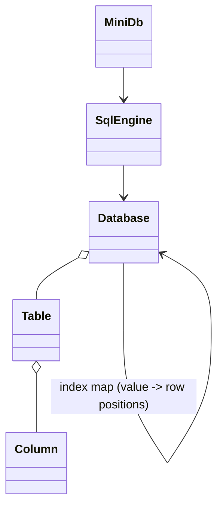
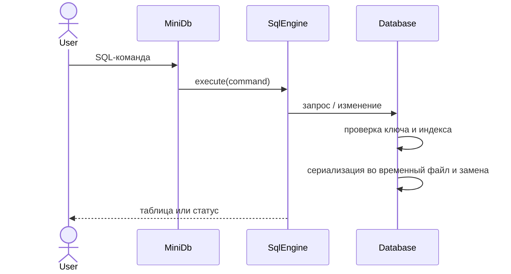

# TransportDB

Учебная файловая СУБД на Java 8 для учёта транспорта и перевозок. В проекте есть консольный SQL-подобный интерфейс, сериализация таблиц, первичные ключи, связь перевозки с транспортом и сохраняемые индексы.

## Запуск

Нужны JDK 8+ и Maven. В каталоге проекта выполните:

```bash
mvn package
java -jar target/transport-db-1.0.jar
```

При первом запуске создаются `vehicles` и `shipments`. Данные и индексы хранятся в `data/database.bin` и `data/indexes.bin`.

## Команды

Команды вводятся в консоли по одной строке. Завершайте команду точкой с запятой. Полный сценарий для проверки находится в [`examples/quickstart.sql`](examples/quickstart.sql).

| Команда | Назначение и пример |
| --- | --- |
| `INSERT INTO table VALUES (...)` | Добавляет запись, перечисляя значения в порядке столбцов. Например: `INSERT INTO vehicles VALUES (1, 'A123AA', 'Volvo FH', 18.5, TRUE);` |
| `INSERT INTO table (columns) VALUES (...)` | Добавляет запись только с указанными столбцами. Остальные получат `NULL`; первичный ключ обязателен. Можно вставить несколько строк: `VALUES (...), (...);` |
| `SELECT columns FROM table` | Показывает выбранные столбцы. Используйте `*`, чтобы вывести все. Например: `SELECT * FROM vehicles;` |
| `SELECT ... WHERE column op value` | Фильтрует строки. Поддерживаются `=`, `!=`, `<>`, `>`, `<`, `>=`, `<=`. Например: `SELECT model FROM vehicles WHERE capacity > 15;` |
| `UPDATE table SET column = value WHERE condition` | Обновляет подходящие записи. Например: `UPDATE shipments SET delivered = TRUE WHERE id = 10;` |
| `DELETE FROM table WHERE condition` | Удаляет подходящие записи. Например: `DELETE FROM shipments WHERE delivered = TRUE;` |
| `CREATE INDEX name ON table (column)` | Создаёт сохраняемый индекс для поиска по равенству. Например: `CREATE INDEX idx_shipments_destination ON shipments (destination);` |
| `CREATE TABLE name (column TYPE PRIMARY KEY, ...)` | Создаёт таблицу. Поддерживаются типы `INT`, `DOUBLE`, `STRING`, `DATE`, `BOOLEAN`; первичный ключ обязателен. |
| `DROP TABLE name` | Удаляет таблицу и её индексы. Нельзя удалить `vehicles`, пока в `shipments` есть записи. |

Если в `UPDATE` или `DELETE` опустить `WHERE`, команда затронет все строки таблицы. Строковые значения заключаются в одинарные кавычки, дату задавайте как `YYYY-MM-DD`. Первичный ключ должен быть уникальным. В `shipments.vehicle_id` указывается существующий `vehicles.id`.

```sql
INSERT INTO vehicles VALUES (1, 'A123AA', 'Volvo FH', 18.5, TRUE);
INSERT INTO shipments VALUES (10, 1, 'Казань', 'Оборудование', 2.75, 2026-05-20, FALSE);
SELECT destination, cargo FROM shipments WHERE vehicle_id = 1;
CREATE INDEX idx_shipments_destination ON shipments (destination);
SELECT destination FROM shipments WHERE destination = 'Казань';
UPDATE shipments SET delivered = TRUE WHERE id = 10;
DELETE FROM shipments WHERE delivered = TRUE;
```

Для завершения работы введите `EXIT`.

## Архитектура

`SqlEngine` разбирает команды и вызывает `Database`; `Database` управляет `Table`, проверяет ключи и связи, обновляет индексы и сохраняет состояние. `MiniDb` отвечает за консоль.





## Индексы и производительность

`CREATE INDEX` строит хеш-индекс для столбца, сохраняет его и восстанавливает при старте. `SELECT ... WHERE column = value` использует индекс, если он создан; остальные условия сканируют строки. Для равенства индекс даёт ожидаемый поиск `O(1) + O(k)` вместо `O(n)`. Здесь `n` обозначает число строк, `k` обозначает число совпадений. При вставке, обновлении и удалении индексы перестраиваются.

Численные замеры не приводятся, поскольку результат зависит от машины и объёма данных. Чтобы сравнить время, загрузите большой набор строк и выполните `SELECT ... WHERE indexed_column = value` до и после `CREATE INDEX`. Повторите запрос несколько раз и сравните среднее время. Индекс ускоряет поиск по равенству. Диапазонные условия выполняются сканированием.

## Надёжность и ограничения

Файл базы записывается во временный файл и затем атомарно заменяется, если файловая система это поддерживает. Индексы можно восстановить из строк таблицы. Это учебная однопользовательская СУБД без транзакционного журнала и конкурентного доступа. Внешний ключ `shipments.vehicle_id` проверяется при вставке и обновлении транспорта.

Проект выполнен индивидуально.

## Проверки

Запустите интеграционные тесты командой `mvn test`. Они проверяют CRUD, уникальность первичного ключа, внешний ключ, `CREATE/DROP TABLE`, а также восстановление данных и индекса после перезапуска.
